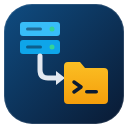
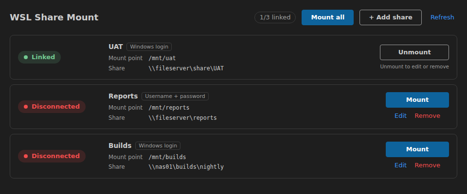
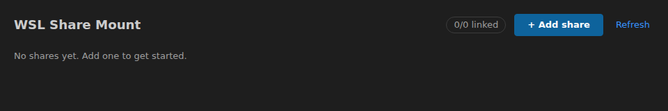

<p align="center"></p>

<h1 align="center">WSL Share Mount</h1>

<p align="center">Mount Windows SMB shares into WSL from VS Code, with the mount state shown in the status bar.</p>

<p align="center">
  <a href="https://marketplace.visualstudio.com/items?itemName=exeltarkus.wsl-share-mount">VS Code Marketplace</a> ·
  <a href="https://open-vsx.org/extension/exeltarkus/wsl-share-mount">Open VSX</a> ·
  <code>ext install exeltarkus.wsl-share-mount</code>
</p>

English | [Bahasa Indonesia](README.id.md)

## Screenshots



*Share Manager: each share shows a **Linked** / **Disconnected** badge with **Mount** / **Unmount**. **Edit** and **Remove** are hidden while a share is mounted ("Unmount to edit or remove").*



*Empty state before any share is added.*

## Installation

- **VS Code Marketplace**: [exeltarkus.wsl-share-mount](https://marketplace.visualstudio.com/items?itemName=exeltarkus.wsl-share-mount)
- **Open VSX** (VSCodium, etc.): [exeltarkus/wsl-share-mount](https://open-vsx.org/extension/exeltarkus/wsl-share-mount)
- **Quick Open** (`Ctrl+P`): `ext install exeltarkus.wsl-share-mount`
- **From a `.vsix`**: Extensions view → `...` → **Install from VSIX...**

Install it in the WSL window (the extension runs in the WSL extension host).

## Requirements

- The extension runs in the **WSL extension host only** (`extensionKind: workspace`). Open your folder with **`WSL: Connect to WSL`**. Outside WSL (detected via `/proc/version`) it stays idle.
- `sudo` inside WSL (needed for `mount` / `umount`).
- For `auth: "credentials"` shares: `cifs-utils` (`sudo apt install cifs-utils`).

## Getting started

1. Click **WSL Share** in the status bar to open the **Share Manager** panel, then click **+ Add share**.
2. Fill in the form (Esc at any step cancels without saving):
   1. **(1/4) Display name**, e.g. `UAT`.
   2. **(2/4) Windows share path (UNC)**, e.g. `\\server\share\UAT`. Forward slashes like `//server/share/UAT` are accepted and converted; a trailing slash is removed.
   3. **(3/4) Mount point** in WSL. Defaults to `/mnt/<name>` (name lowercased, other characters turned into `-`). Must be an absolute path not used by another share.
   4. **(4/4) Login**: **Current Windows login** (`windows`) or **Username + password** (`credentials`). For the latter you can enter a username such as `CORP\user`; leave it empty to be asked on every mount.
3. Click **Mount** on the share's row (and **Unmount** later).

## Share Manager panel

- Header: `linked/total` summary, **Mount all** (shown when more than one share is disconnected), **+ Add share** and **Refresh**.
- Each row: **Linked** / **Disconnected** badge, name, login type, mount point and UNC path, plus **Mount** or **Unmount**.
- **Edit** / **Remove** appear only while the share is not mounted. Removing asks for confirmation.
- The panel updates by itself after every action and whenever the mount state is refreshed.

## Features

- **Two auth modes**:
  - `windows` (default): `mount -t drvfs` with `uid`/`gid`/`metadata`, using your current Windows login. No password needed.
  - `credentials`: `mount -t cifs //server/share/...` with a username and password. The username comes from the setting or is asked; the password is **always asked and never stored**. It is passed through a temporary `0600` credentials file in `$XDG_RUNTIME_DIR` that is deleted right after mounting, so it never shows up in `ps`. `DOMAIN\user` is split into domain + username; `user@domain` is passed as-is.
- **sudo only when needed**: tries `sudo -n` first and only asks for the sudo password if it is required. The password is sent via stdin and not stored.
- **Ask once per batch**: when mounting several shares at once (**Mount all** or a multi-select), the sudo password and each share password (per username) are asked only once.
- **Batch-safe**: one share failing does not stop the others. Cancelling a password prompt cancels the rest of the batch.
- **Non-empty folder check**: mounting onto a non-empty folder asks for confirmation. The local contents are hidden (not deleted) while the share is mounted.
- **Reconnect after WSL restart**: mounts are not persistent (nothing is written to `/etc/fstab`), so `wsl --shutdown` drops them. On the next start, shares that were mounted before are reported as disconnected with a **Mount again** button.
- **Status bar**: `WSL Share: none`, `WSL Share: 0/N mounted`, the share's name when exactly one is mounted, or `X/N mounted`. Green when all shares are mounted, yellow when only some are. The tooltip lists each share as MOUNTED / NOT MOUNTED (or "No shares configured. Click to add one."). Clicking it opens the Share Manager. It refreshes when the settings change and when the window regains focus (e.g. after mounting from the terminal).

## Commands

| Command | Description |
| --- | --- |
| `WSL Share Mount: Open Share Manager` | Open the Share Manager panel (same as clicking the status bar) |
| `WSL Share Mount: Mount Share` | Mount shares that are not mounted yet (multi-select picker when more than one) |
| `WSL Share Mount: Unmount Share` | Unmount mounted shares (multi-select picker when more than one) |
| `WSL Share Mount: Show Status` | `MOUNTED` / `NOT MOUNTED` per mount point, with the real source from `findmnt` (opens **Add Share** when no shares are configured) |
| `WSL Share Mount: Add Share` | Step-by-step form to add a share |
| `WSL Share Mount: Edit Share` | Pick a share and edit it in the same form (refused while mounted: "Unmount it first") |
| `WSL Share Mount: Remove Share` | Pick a share and remove it after confirmation (refused while mounted) |
| `WSL Share Mount: Open Settings (JSON)` | Optional/advanced: open `settings.json` at `wslShareMount.shares` |

## Settings

Shares are stored in `wslShareMount.shares` (machine scope). The Add / Edit / Remove forms write it to your **user** settings and leave any other entries untouched (even invalid ones). It is an array of:

| Field | Required | Description |
| --- | --- | --- |
| `name` | yes | Label shown in the panel and pickers |
| `share` | yes | UNC path, e.g. `\\server\share\folder` (backslashes doubled in JSON) |
| `mountPoint` | yes | Absolute WSL path, must be unique, e.g. `/mnt/share` |
| `auth` | no | `"windows"` (default) or `"credentials"` |
| `username` | no | Only for `auth: "credentials"`, e.g. `DOMAIN\user`. Asked on mount when empty |

Invalid entries and duplicate `mountPoint`s are ignored, with a warning in the **WSL Share Mount** output channel.

### Advanced: edit JSON directly

You can still edit the setting by hand (**Open Settings (JSON)**). Example:

```json
"wslShareMount.shares": [
  { "name": "UAT", "share": "\\\\server\\share\\UAT", "mountPoint": "/mnt/uat" },
  {
    "name": "Reports",
    "share": "\\\\fileserver\\reports",
    "mountPoint": "/mnt/reports",
    "auth": "credentials",
    "username": "CORP\\user"
  }
]
```

## Known limitations

- A wrong share password is reused for the rest of that batch; run the action again to retry.
- Mounts do not survive a WSL restart (see **Reconnect after WSL restart**).
- UI text is English only.

## Development

```bash
npm install
npm test              # compile + unit tests (node --test)
npm run package       # build the .vsix (vsce)
npm run install:local # build + install into your local VS Code (add -- --force to reinstall the same version)
npm run screenshots   # regenerate images/icon.png and images/screenshots/*.png
```

Press `F5` in VS Code (**Run Extension**) to launch the Extension Development Host.

## License

MIT
